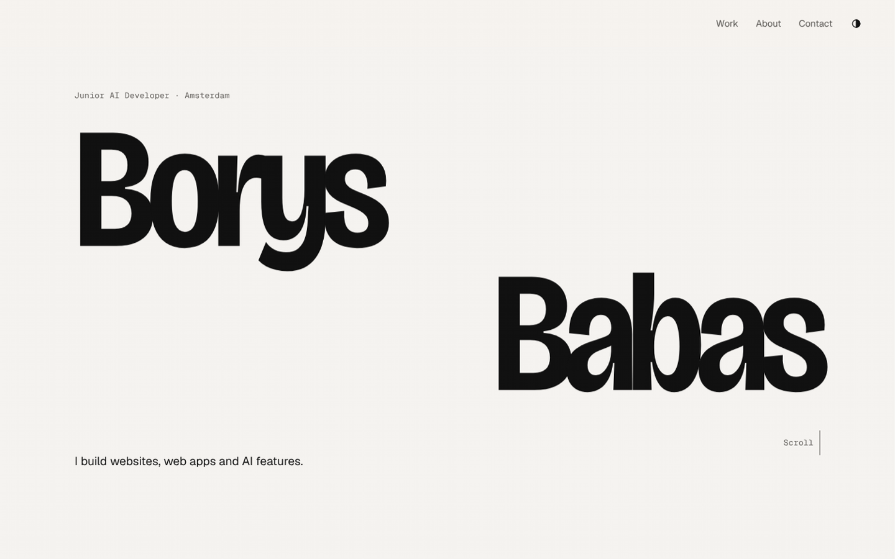

# borysbabas.dev



The source of [borysbabas.dev](https://borysbabas.dev): my one-page portfolio, in English, Dutch and Polish. The
project list is built from my public GitHub repositories, so a new repo with a good README shows up on its own. There
is also Stash, a private page that turns pasted links into cards.

## Stack

| | |
|---|---|
| Framework | Nuxt 4, Vue 3, TypeScript |
| Styling | Tailwind CSS 4 via `@tailwindcss/vite`, mapped onto the site's own design tokens |
| Languages | `@nuxtjs/i18n` for the routes (`/`, `/nl`, `/pl`); the text itself lives in `content/` |
| Theme | `@nuxtjs/color-mode`, light and dark |
| Data | GitHub REST API for the projects, Supabase for Stash |
| AI | Anthropic SDK: Claude reads Stash links into cards |
| Hosting | Vercel, with Analytics and Speed Insights |

## Getting started

```bash
npm install
cp .env.example .env   # optional: add a GITHUB_TOKEN to raise the GitHub rate limit
npm run dev            # http://localhost:3000
```

```bash
npm run build
npm run preview
```

## Selected work

`server/api/github/repos.get.ts` fetches my non-fork repositories once and caches the result for an hour; each home
page is also cached for an hour on Vercel (`isr` in `nuxt.config.ts`). For every repo the card uses:

| Card | Comes from |
|---|---|
| Title | The README's first heading |
| Text | The repo description, minus a leading `Name:` and a trailing `HvA school project.` |
| Label | `school-project` → School, `client-website` → Client, otherwise Personal |
| Tags | The first four other topics |
| Image | The README's first markdown image, resolved to `raw.githubusercontent.com` |
| Links | The repo, and its homepage when one is set |

Cards with an image come first. The profile README and this repo are hidden. A token is optional; see
[docs/GITHUB_TOKEN_SETUP.md](docs/GITHUB_TOKEN_SETUP.md).

## Stash

A private page at `/stash` (double-click the `.dev` in the footer). Paste a link and Claude reads it into a card: a
recipe, a product, an article.

- Settings are environment variables; see the Stash section of `.env.example`.
- Cards live in Supabase, in the tables from `supabase/stash.sql`.
- Five wrong passwords in 15 minutes lock sign-in for 15 minutes, and email you when it happens.

## Project structure

| Path | |
|---|---|
| `pages/index.vue` | The one-page home |
| `pages/privacy.vue`, `pages/terms.vue` | Legal pages, on `layouts/default.vue` |
| `pages/stash/` | The private stash and a page per card |
| `components/` | `SiteNav`, `SiteFooter`, `SiteCursor`, `LegalPage` and the stash's cooking mode |
| `content/` | All site and legal text, per language; read through `composables/useText.ts` |
| `assets/css/site.css` | The design: tokens, layout and motion |
| `assets/css/main.css` | Tailwind, mapped onto the design's tokens |
| `server/api/github/repos.get.ts` | The cached GitHub project list |
| `server/api/stash/`, `server/utils/` | Stash sign-in and cards |
| `supabase/stash.sql` | Tables for Stash |
